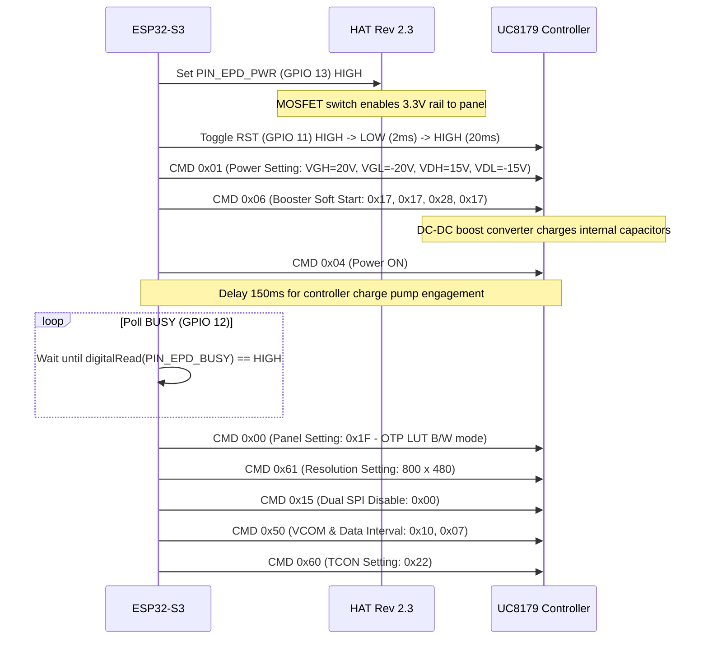

# Technical Design Document: DART E-Paper Announcer

**Project:** DART Realtime Transit Announcement Display  
**Target Hardware:** Adafruit ESP32-S3 Feather + Waveshare 7.5" E-Paper Display V2 (HAT Rev 2.3)  
**Display Specification:** 800 × 480 Monochrome E-Ink (UC8179 Controller)  
**Document Version:** 1.4  
**Status:** Implemented & Verified in Hardware  

---

## 1. System Overview

The **DART E-Paper Announcer** is an autonomous, Wi-Fi-connected desktop/wall information terminal that provides real-time train departure schedules for the Dublin Area Rapid Transit (DART) rail network operated by Iarnród Éireann (Irish Rail).

The device downloads live transit XML feeds directly from the public Irish Rail Realtime API, renders a high-contrast transit board buffer in RAM, drives a physical 7.5-inch electrophoretic (e-ink) display over high-speed SPI, and hosts an embedded web portal for live monitoring and configuration.

```mermaid
flowchart TD
    subgraph External_Services["External Services"]
        IR["Irish Rail Realtime API\n(getStationDataByCodeXML)"]
        DB["Dublin Bus Timetable Feeds\n(bustimes.org H1 Stop 917 & H2 Stop 929)"]
        OM["Open-Meteo Weather API\n(Forecast & Precipitation)"]
    end

    subgraph ESP32S3["Adafruit ESP32-S3 Feather"]
        WiFi["Wi-Fi / mDNS Engine\n(dart-display.local)"]
        Parser["XML & HTML Parsing Engine\n(dart::Parser)"]
        Canvas["800x480 1-Bit Canvas Engine\n(3-Section Multimodal Board)"]
        WebServer["Embedded Web Server\n(Live BMP Preview & Portal)"]
        EPD_Driver["Waveshare UC8179 Driver\n(Booster Soft-Start & Inverted DTM)"]
        FuelGauge["MAX17048 I2C Fuel Gauge\n(Battery Telemetry)"]
    end

    subgraph Hardware_Peripherals["Display Subsystem"]
        HAT["Waveshare e-Paper HAT Rev 2.3\n(Power Switch & Level Shifting)"]
        Panel["Waveshare 7.5\" V2 E-Paper\n(800x480 Monochrome E-Ink)"]
    end

    IR -->|HTTP XML| Parser
    DB -->|HTTPS HTML| Parser
    OM -->|HTTP JSON| WiFi
    WiFi --> Parser
    Parser --> Canvas
    Canvas -->|1-bit BMP 48KB| WebServer
    Canvas -->|48,000 bytes Raw Frame| EPD_Driver
    FuelGauge --> Canvas
    EPD_Driver -->|SPI + Control Lines| HAT
    HAT -->|24-pin FPC| Panel
```

---

## 2. Hardware Architecture & Wiring Specification

### 2.1 Component Bill of Materials

| Component | Part Description | Role / Purpose |
| :--- | :--- | :--- |
| **Microcontroller** | Adafruit ESP32-S3 Feather (4MB Flash, 2MB PSRAM) | Dual-core 240MHz Xtensa LX7, Wi-Fi 4, Native USB-CDC, Onboard LiPo charger |
| **Display Panel** | Waveshare 7.5-inch E-Paper Display V2 (Monochrome) | 800 × 480 resolution, bistable electrophoretic display, UC8179 driver IC |
| **Interface Board**| Waveshare Universal e-Paper Driver HAT **Rev 2.3** | Level shifting, booster circuit, physical A/B switch, and MOSFET power switch |
| **Power Source** | 3.7V LiPo Battery (2500mAh) or USB-C (5V) | Primary operating power |

---

### 2.2 Pinout Mapping (Adafruit ESP32-S3 Feather to HAT Rev 2.3)

On the **Waveshare e-Paper HAT Rev 2.3**, power to the display panel is governed by an onboard power gate controlled via the **`PWR`** pin. Both the control signals and power switch must be asserted in firmware:

| Wire Color | HAT Rev 2.3 Pin | Signal Function | Adafruit Feather S3 Pin | GPIO Number | Description |
| :--- | :--- | :--- | :--- | :--- | :--- |
| **Red** | `VCC` | Power Supply | **`3V`** | — | 3.3V Output from Feather LDO |
| **Black** | `GND` | Common Ground | **`GND`** | — | System ground |
| **Blue** | `DIN` | SPI MOSI | **`MO`** | **GPIO 35** | SPI Master Out Slave In |
| **Yellow** | `CLK` | SPI SCK | **`SCK`** | **GPIO 36** | SPI Hardware Clock |
| **Orange** | `CS` | Chip Select | **`D9`** | **GPIO 9** | SPI Slave Select (Active LOW) |
| **Green** | `DC` | Data / Command | **`D10`** | **GPIO 10** | High = Data, Low = Command |
| **White** | `RST` | Hardware Reset | **`D11`** | **GPIO 11** | Panel Reset (Active LOW) |
| **Purple**| `BUSY` | Status Output | **`D12`** | **GPIO 12** | 0 = Busy, 1 = Ready (Active LOW) |
| **Brown** | `PWR` | Power Gate Enable| **`D13`** | **GPIO 13** | High = HAT Power ON, Low = OFF |

---

### 2.3 Hardware Switch & Jumper Configurations

1. **Display Config Switch (`A / B`)**:
   * **Required Setting:** **`B`**
   * *Rationale:* Position `B` configures the 0.47Ω current-sense resistor network and VCOM driving voltage required for large 7.5-inch panels. (Position `A` is calibrated for small 2.13"/2.9" displays and causes the 7.5" panel's charge pump to fail).
2. **Interface Config Switch (`0 / 1` or `4-line / 3-line`)**:
   * **Required Setting:** **`0`** (or **`4-line SPI`**)
   * *Rationale:* Standard 4-wire SPI mode utilizing dedicated `DC` pin framing.
3. **FPC Ribbon Cable Connection**:
   * **Connector Type:** 24-pin 0.5mm pitch ZIF rear-flip socket.
   * **Contact Direction:** **Exposed gold contacts must face UP** (facing away from the PCB). The solid plastic stiffener strip faces DOWN toward the board.
   * **Latching:** Hinged latch must be fully flipped down to clamp the cable contacts against the connector pins.

---

## 3. Low-Level E-Paper Driver Specification (UC8179)

The Waveshare 7.5" V2 panel is driven by the UltraChip **UC8179** display controller over SPI Mode 0 at 4MHz.

### 3.1 Initialization Sequence (`epdInit`)



> [!IMPORTANT]
> **Booster Soft Start (`0x06`)**:
> Without command `0x06` and its parameters (`0x17, 0x17, 0x28, 0x17`), the controller cannot generate the high-voltage electrical fields (up to ±20V) required to overcome electrophoretic viscosity. Omitting this command leaves the panel completely blank.

---

### 3.2 Dual-Plane Framebuffer Transmission (`epdDisplay`)

The UC8179 controller maintains two internal RAM planes in monochrome mode:
* **DTM1 (`0x10` - Data Transmission 1)**: Primary frame plane.
* **DTM2 (`0x13` - Data Transmission 2)**: Complementary frame plane.

In order for the controller's onboard Look-Up Table (LUT) to drive black and white microcapsules:
1. **DTM1 (`0x10`)** is loaded with the raw image buffer:
   $$\text{DTM1}[i] = \text{Buffer}[i] \quad (1 = \text{White}, 0 = \text{Black})$$
2. **DTM2 (`0x13`)** is loaded with the **bitwise inverted** image buffer:
   $$\text{DTM2}[i] = \sim\text{Buffer}[i] \quad (0 = \text{White}, 1 = \text{Black})$$
3. Both transfers transmit exactly **48,000 bytes** ($800 \times 480 \div 8$) in chunks of 2,048 bytes to prevent SPI FIFO overflow.
4. **Display Refresh (`0x12`)** is triggered, followed by a 200ms delay to allow the controller to assert `BUSY = LOW`. The microcontroller then waits for `BUSY = HIGH` (typically 3 to 4 seconds).

> [!CAUTION]
> **Avoid SPI Polling (`0x71`) during Busy**:
> Earlier firmware revisions polled SPI status command `0x71` inside the busy wait loop. Sending SPI clock and chip-select toggles while the UC8179 internal state machine is cycling voltages aborts the refresh and causes display freeze. Polling must strictly be passive pin monitoring (`digitalRead(PIN_EPD_BUSY)`).

---

### 3.3 Deep Sleep Sequence (`epdSleep`)

To prevent microcapsule degradation and avoid battery drain:
1. `CMD 0x50` with data `0xF7` (VCOM retention release).
2. `CMD 0x02` (Power OFF).
3. Passive wait for BUSY release.
4. `CMD 0x07` with data `0xA5` (Deep sleep mode, reduces panel standby current to $<2\mu\text{A}$).
5. Release SPI bus lock (`SPI.endTransaction()`).

---

## 4. Software Architecture & Implementation

### 4.1 Memory Layout & Canvas Engine (`dart::Canvas`)

The graphics subsystem is implemented in clean C++ (`dart_canvas.hpp`) without dynamic heap fragmentation.

* **Resolution:** 800 pixels (width) $\times$ 480 pixels (height).
* **Framebuffer Size:** 48,000 bytes ($800 \times 480 \div 8$).
* **Pixel Encoding:** 1 bit per pixel.
  $$\text{Byte Index} = y \times 100 + (x \gg 3), \quad \text{Bit Mask} = 0x80 \gg (x \ \& \ 7)$$
  * Bit value `1` = White (Background)
  * Bit value `0` = Black (Ink)

#### Visual Hierarchy (2 Transit Sections + 1-Line Footer):
1. **Section 1: DART Departures (Y: 0–220)**:
   * Inverted header title bar (Y: 0–38):
     * Left ($X = 24$): `DART  •  <STATION>  •  <DIRECTION>` (e.g. `DART • SUTTON • SOUTHBOUND`).
     * Right (right-aligned to $X = 776$): Current Time (`<HH:MM>`, e.g. `16:30`) in scale 3 white text.
   * Next 2 upcoming trains (Row 1 at Y: 59, Row 2 at Y: 123) featuring prominent inverted countdown badges (56px tall, `DUE` / `<min> MIN`), bold destination station (35px tall), expected departure time, and real-time status. Compact 8px gap between rows without artificial whitespace voids or horizontal divider lines.
   * **Empty State**: Centered 2-line message (`NO UPCOMING DART DEPARTURES` / `NO TRAINS SCHEDULED (NEXT 90 MIN)`) when no trains are operating in the schedule window.
2. **Section 2: Dublin Bus Departures (Y: 221–443)**:
   * Section divider line at Y: 221.
   * Inverted header title bar (Y: 223–261): `DUBLIN BUS  •  H1 (STOP 917)  •  H2 (STOP 929)`.
   * Next Bus from each route (Route 1: H1 from Admiral Park stop 917; Route 2: H2 from Warrenhouse Road stop 929):
     * Each route gets ONE ROW each or NO ROW (sorted by arrival countdown minutes, up to 2 buses total).
     * Row 1 (Y: 282) and Row 2 (Y: 346) featuring:
       * Inverted countdown badge at X: 24 to 140 (56px tall, `DUE` / `<min> MIN`).
       * Inverted route badge at X: 150 to 210 (`[ H1 ]` or `[ H2 ]`, 60px wide, 56px tall).
       * Clean destination station at X: 220 (auto-scaled, stripped of vehicle registration IDs).
       * Expected departure time at X: 475 (`EXP: <HH:MM>`).
       * Live status right-aligned to X: 776 (`LIVE` / `SCHED`).
   * **Empty State**: Centered 2-line notification (`NO UPCOMING BUS DEPARTURES` / `NO BUSES SCHEDULED (NEXT 90 MIN)`) when off-peak or no buses are due across both routes.
3. **Footer: Single-Line Dashboard (Y: 444–480)**:
   * Solid divider line at Y: 444 spanning the full 800px display width.
   * Uncluttered 2-item layout (`WEATHER` and `BATTERY`) at Y: 455 with $> 125$px buffer:
     * **Weather**: `WEATHER: <TEMP>°C  •  RAIN: <RAIN>%` with dynamically sized `[UMBRELLA]` badge if rain $\ge 40\%$ (Left, $X = 24$).
     * **Battery**: `<PERCENT>%` with visual fuel gauge icon, omitting the redundant `BATTERY:` text prefix (Right, right-aligned to $X = 776$).

#### Horizontal Column Coordinate Grid (Zero-Overlap Guarantee across 800px Width):
To eliminate text collisions between destination, expected time (`EXP: HH:MM`), and status (`ON TIME` / `LIVE` / `SCHED` / `DELAY`), departures use a right-aligned column grid:

| Column | X Range | Width | Scale / Styling | Alignment & Behavior |
| :--- | :--- | :--- | :--- | :--- |
| **Left Margin** | `X: 0..23` | 24 px | — | Symmetrical left border |
| **Countdown Badge** | `X: 24..139` | 116 px | Scale 3 (`56px` tall) | Inverted solid black pill (`DUE` / `<min> MIN`) |
| **Destination** | `X: 156..441` | $\le 285$ px | Scale 5 ($\le 9$ ch), 4 ($\le 12$ ch), 3 ($> 12$ ch) | Auto-scaling based on text length (max 16 chars) |
| **Expected Time** | `X: 455..632` | 177 px | Scale 3 (`EXP: HH:MM`) | Fixed start at $X=455$, $\ge 21$px gap to status |
| **Status** | `X: 653..776` | $\le 123$ px | Scale 3 (`ON TIME`/`LIVE`/`SCHED`) or Scale 2 pill (`DELAY`) | **Right-aligned** against $X = 776$ |
| **Right Margin** | `X: 776..799` | 24 px | — | Symmetrical 24px right border |

---

### 4.2 Dynamic Station Discovery & Geocoding

Rather than relying on a static, compile-time list of stations, the firmware queries the Irish Rail endpoint at boot:
$$\text{Endpoint: } \texttt{http://api.irishrail.ie/realtime/realtime.asmx/getAllStationsXML\_WithStationType?StationType=D}$$

1. The XML stream is parsed on-chip to populate `g_dart_stations` with all active DART network stations.
2. If network connectivity fails, the firmware falls back to a curated list of all 32 core DART stations from Malahide/Howth to Greystones.

---

### 4.3 Embedded Web Server & Telemetry Dashboard

The ESP32-S3 hosts an asynchronous HTTP server on port 80:

| URI Route | Method | Functionality |
| :--- | :--- | :--- |
| **`/`** | `GET` | Live Preview Dashboard with dynamically generated 800×480 BMP preview. |
| **`/screen.bmp`** | `GET` | 48,062-byte uncompressed 1-bit Windows BMP image generated on-chip. |
| **`/config`** / **`/setup`** | `GET` | Configuration portal for changing station, direction, schedule, and Wi-Fi. |
| **`/save`** | `POST` | Saves configuration to NVS, sends instant 302 redirect, and triggers refresh. |
| **`/refresh`** | `GET` | Triggers immediate API re-query and display redraw. |
| **`/toggle-theme`** | `GET` | Inverts display buffer (White-on-Black / Dark Mode) instantly in RAM. |

* **mDNS Responder:** Broadcasts as `http://dart-display.local/` via Multicast DNS.
* **Instant Station Switching:** Settings updates return a redirect payload immediately to prevent browser TCP timeouts while the display executes its 4-second physical refresh in the background.

---

### 4.4 Power Management & Battery Telemetry

1. **Ultra-Low-Power Deep Sleep Architecture (`prepareForDeepSleep`)**:
   * **Root Cause of 24h Drain:** A desk prototyping override (`g_test_mode = true`) previously prevented the ESP32 from entering deep sleep, forcing the Wi-Fi radio and HTTP preview server to run 24/7 (~110mA continuous drain $\approx$ 24 hours on a 2500mAh cell).
   * **Battery Wall Frame Mode:** Default operating mode. The ESP32 wakes, connects to Wi-Fi, fetches DART and bus departures, renders to the Waveshare e-paper, isolates all peripherals, and enters ESP32-S3 deep sleep ($< 30\mu\text{A}$ standby current).
   * **Dynamic Commute Refresh Scheduling:**
     * Commute Active Departures (06:00–21:00): Live DART and Dublin Bus departures (refresh every 90s during peak commute, 300s off-peak).
     * Night Standby (21:00–06:00): Low-power night standby clock & tomorrow's Open-Meteo weather forecast (refreshes every 1800s / 30 minutes).
     * Expected Battery Life on 2500mAh LiPo: **25 to 30 days (approx. 1 month)**.
   * **Peripheral Power Rail Isolation:**
     * `PIN_EPD_PWR` (GPIO 13): Drives the Waveshare HAT Rev 2.3 MOSFET power switch. Driven `LOW` before sleep to cut 3.3V rail to the HAT, level shifters, and boost circuit.
     * Onboard NeoPixel: `setStatusLed(0,0,0)` and `NEOPIXEL_POWER` turned off.
     * I2C Bus: `PIN_I2C_POWER` driven `LOW`.
     * SPI Bus: Released and pins isolated to eliminate parasitic leakage.
     * Radios: `WiFi.disconnect()`, `WiFi.mode(WIFI_OFF)`, `btStop()`, and `esp_wifi_stop()`.
     * Manual Wake-up: `esp_sleep_enable_ext0_wakeup((gpio_num_t)PIN_BOOT_BTN, 0)` enables immediate refresh on pressing the BOOT button.

2. **Battery Telemetry & Fallback Voltage Divider**:
   * **Primary:** Reads MAX17048 I2C fuel gauge (Address `0x36`) when present.
   * **Analog Fallback:** Reads Adafruit Feather ESP32-S3 onboard 200k/200k voltage divider on `PIN_VBAT` (GPIO 1 / A13) using calibrated `analogReadMilliVolts(PIN_VBAT) * 2`.
   * **LiPo Curve Approximation:** $3.30\text{V} = 0\%$, $4.15\text{V} = 100\%$.
   * **Critical Low-Battery Cutoff:** If $V_{\text{BAT}} < 3.25\text{V}$, the display renders a `BATTERY CRITICALLY LOW - PLEASE RECHARGE VIA USB-C` warning and halts execution in 12-hour deep sleep to protect the LiPo cell from permanent over-discharge.

3. **Night Standby Screen Layout (`render_clock_weather_screen`)**:
   * **Left Column (X: 0–400):** Big digital clock (scale 6), standby mode subtitle, resume schedule box (auto-sized to text width), and low-power sleep status.
   * **Right Column (X: 400–800):** Tomorrow's commute weather banner, temperature range, rain probability badge, and multi-line commuter advice:
     * Weather preparation advice wrapped across 2 lines (`CLEAR MORNING COMMUTE` / `NO UMBRELLA NEEDED` or `HEAVY RAIN EXPECTED` / `BRING AN UMBRELLA`).
     * Transit status wrapped across 2 lines (`NORMAL SCHEDULED` / `SERVICE EXPECTED`).
     * Eliminates text truncation and right-edge display overflow.

4. **Over-The-Air (OTA) Web Firmware Updates (`/update`)**:
   * **Browser-Based Wirelessly Flashing:** Eliminates the need to ever connect a USB cable or use the Arduino IDE for sketch updates.
   * **Endpoints:**
     * `GET /update`: Dedicated dark-mode portal displaying flash health (total flash, sketch size, free app slot) with drag-and-drop file selector for `.bin` files and real-time upload progress bar (percentage, bytes transferred, transfer status).
     * `POST /update`: Handles multipart upload streaming chunks into ESP32 flash via `<Update.h>`, validating MD5 checksum and setting the active boot partition upon success before triggering an automatic software reboot.
   * **Dual Partition Boot Safety:** Uses standard ESP32 dual-app OTA scheme (`ota_0` and `ota_1`, 1.28MB each in `default.csv` / 1.92MB each in `min_spiffs.csv`). If an upload is aborted or corrupted, the bootloader remains pointed at the existing valid partition, making firmware flashing completely brick-proof.
   * **Accessible in Both Modes:**
     * **Desk / Test Mode:** Available 24/7 on `http://dart-display.local/update` (and linked directly from `/` and `/config`).
     * **Battery Wall Frame Mode:** Holding the physical **BOOT** button for 2 seconds enters Setup Mode, enabling both the `DART-Frame-Setup` SoftAP hotspot (`http://192.168.4.1/update`) and home Wi-Fi station connectivity (`http://dart-display.local/update`).
   * **Visual Status Feedback:** The onboard NeoPixel turns magenta during active OTA flashing, green on successful flash and verification, and red if an error occurs.

---

## 5. Build & Deployment Specifications

### 5.1 Arduino IDE Board Configuration

* **Board:** `Adafruit Feather ESP32-S3 No PSRAM` or `ESP32S3 Dev Module`
* **Flash Size:** `4MB`
* **Partition Scheme:** `Default 4MB with spiffs (1.2MB APP / 1.5MB SPIFFS)`
* **USB CDC On Boot:** `Enabled` *(Crucial for Serial Monitor logs)*
* **CPU Frequency:** `240MHz (WiFi)`
* **Upload Speed:** `921600`

### 5.2 Source Code Structure

```
DART_ANNOUNCE/
├── firmware/
│   ├── core/                      # Platform-agnostic C++ core
│   │   ├── dart_canvas.hpp        # 800x480 1-bit monochrome graphics engine
│   │   ├── dart_font.hpp          # Scalable proportional font rasterizer
│   │   ├── dart_parser.hpp        # Irish Rail realtime XML parser
│   │   └── dart_types.hpp         # Shared data models & structs
│   └── esp32_dart_display/        # Production ESP32-S3 firmware
│       ├── dart_canvas.hpp
│       ├── dart_font.hpp
│       ├── dart_parser.hpp
│       ├── dart_types.hpp
│       └── esp32_dart_display.ino # Main sketch (FreeRTOS, WebServer, UC8179 driver)
└── docs/
    └── TECHNICAL_DESIGN_DOCUMENT.md
```

---

## 6. Verification & Test Matrix

| Test Case | Verification Criteria | Status |
| :--- | :--- | :--- |
| **Power-On Voltage Rail** | Pin D13 drives HAT Rev 2.3 MOSFET gate HIGH; 3.3V rail active. | **PASS** |
| **UC8179 Initialization** | Booster soft-start (`0x06`) executes; BUSY drops LOW then releases. | **PASS** |
| **Dual Plane Transfer** | DTM1 receives 48,000 bytes; DTM2 receives 48,000 inverted bytes. | **PASS** |
| **Physical Refresh** | E-Paper panel flashes and presents crisp monochrome departures. | **PASS** |
| **Live API Ingestion** | Irish Rail XML parses train destinations, due times, and query time. | **PASS** |
| **Web Preview Stream** | `/screen.bmp` renders pixel-perfect 800×480 graphic in browser. | **PASS** |
| **Station Switching** | Web portal dropdown updates station and triggers instant refresh. | **PASS** |
| **Telemetry Alignment** | Battery telemetry rendered cleanly in bottom right without overlap. | **PASS** |
